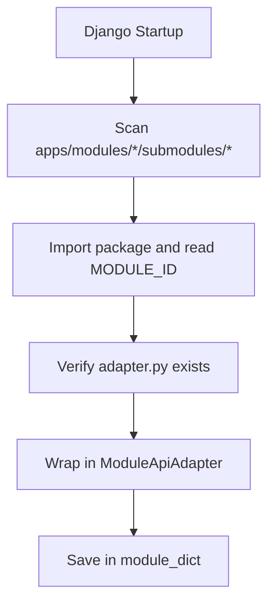

# Chapter 10: Modules Catalog & Status Directory

Osdag-Web organizes its engineering design modules into structured catalog directories. The catalog is rendered on the client side using configuration mappings and auto-discovered dynamically on the server side using adapter registries.

---

## 10.1 Active Modules Directory

Operational modules are rendered as card options on the homepage. Users can navigate to them to execute calculation parameters and compile 3D CAD graphics. Every module is one entry in [registry.js](../frontend/src/modules/registry.js); the cards are built from the entries' `menu` fields by [ModulesCardLayout.jsx](../frontend/src/homepage/components/ModulesCardLayout.jsx). A module's id is its desktop module name, the same string as the backend `MODULE_ID`.

The following table lists all active production modules in the system:

| Catalog Submodule | Card Label | Module id (`Common.py` name) | Frontend Route Path | Backend Adapter Registry |
| :--- | :--- | :--- | :--- | :--- |
| **Shear Connection** | Fin Plate | `Fin Plate Connection` | `/design/connections/shear/fin_plate` | `apps.modules.shear_connection.submodules.fin_plate` |
|  | Cleat Angle | `Cleat Angle Connection` | `/design/connections/shear/cleat_angle` | `apps.modules.shear_connection.submodules.cleat_angle` |
|  | Header Plate | `Header Plate Connection` | `/design/connections/shear/end_plate` | `apps.modules.shear_connection.submodules.header_plate` |
|  | Seated Angle | `Seated Angle Connection` | `/design/connections/shear/seatAngle` | `apps.modules.shear_connection.submodules.seated_angle` |
| **Moment Connection** | Column Splices: Cover Plate (Bolted) | `Column-to-Column Cover Plate Bolted Connection` | `/design/connections/column-to-column-splice/cover_plate_bolted` | `apps.modules.moment_connection.submodules.column_column_cover_plate_bolted` |
|  | Column Splices: Cover Plate (Welded) | `Column-to-Column Cover Plate Welded Connection` | `/design/connections/column-to-column-splice/cover_plate_welded` | `apps.modules.moment_connection.submodules.column_column_cover_plate_welded` |
|  | Column Splices: End Plate | `Column-to-Column End Plate Connection` | `/design/connections/column-to-column-splice/end_plate` | `apps.modules.moment_connection.submodules.column_column_end_plate` |
|  | Beam Splices: Cover Plate (Bolted) | `Beam-to-Beam Cover Plate Bolted Connection` | `/design/connections/beam-to-beam-splice/cover_plate_bolted` | `apps.modules.moment_connection.submodules.beam_beam_cover_plate_bolted` |
|  | Beam Splices: Cover Plate (Welded) | `Beam-to-Beam Cover Plate Welded Connection` | `/design/connections/beam-to-beam-splice/cover_plate_welded` | `apps.modules.moment_connection.submodules.beam_beam_cover_plate_welded` |
|  | Beam Splices: End Plate | `Beam-to-Beam End Plate Connection` | `/design/connections/beam-to-beam-splice/end_plate` | `apps.modules.moment_connection.submodules.beam_beam_end_plate` |
|  | Beam to Column: End Plate | `Beam-to-Column End Plate Connection` | `/design/connections/column-beam/end_plate` | `apps.modules.moment_connection.submodules.beam_column_end_plate` |
| **Plated Connection** | Lap Joint — Bolted | `Lap Joint Bolted Connection` | `/design/connections/simple/lap_joint_bolted` | `apps.modules.simple_connection.submodules.lap_joint_bolted` |
|  | Lap Joint — Welded | `Lap Joint Welded Connection` | `/design/connections/simple/lap_joint_welded` | `apps.modules.simple_connection.submodules.lap_joint_welded` |
|  | Butt Joint — Bolted | `Butt Joint Bolted Connection` | `/design/connections/simple/butt_joint_bolted` | `apps.modules.simple_connection.submodules.butt_joint_bolted` |
|  | Butt Joint — Welded | `Butt Joint Welded Connection` | `/design/connections/simple/butt_joint_welded` | `apps.modules.simple_connection.submodules.butt_joint_welded` |
| **Base Plate** | Slab & Gusseted Bases | `Base Plate Connection` | `/design/connections/base_plate` | `apps.modules.base_plate` |
| **Tension Member** | Bolted to End Gusset | `Tension Member Design - Bolted to End Gusset` | `/design/tension-member/bolted_to_end_gusset` | `apps.modules.tension_member.submodules.bolted` |
|  | Welded to End Gusset | `Tension Member Design - Welded to End Gusset` | `/design/tension-member/welded_to_end_gusset` | `apps.modules.tension_member.submodules.welded` |
| **Compression Member** | Struts Bolted to End Gusset | `Struts Bolted to End Gusset` | `/design/compression-member/struts_bolted_to_end_gusset` | `apps.modules.compression_member.submodules.struts_bolted` |
|  | Struts Welded to End Gusset | `Struts Welded to End Gusset` | `/design/compression-member/struts_welded_to_end_gusset` | `apps.modules.compression_member.submodules.struts_welded` |
|  | Axially Loaded Column | `Columns with known support conditions` | `/design/compression-member/axially_loaded_column` | `apps.modules.compression_member.submodules.axially_loaded_column` |
| **Flexure Member** | Simply Supported Beam | `Flexural Members - Simply Supported` | `/design/flexure_member/simply_supported_beam` | `apps.modules.flexure_member.submodules.simply_supported_beam` |
|  | Cantilever Beam | `Flexural Members - Cantilever` | `/design/flexure/on_cantilever` | `apps.modules.flexure_member.submodules.on_cantilever` |
|  | Plate Girder | `PLATE GIRDER` | `/design/flexure/plate_girder` | `apps.modules.flexure_member.submodules.plate_girder` |

---

## 10.2 Under-Development & Hidden Modules Directory

Several modules in the codebase are disabled, hidden, or lack a homepage card.

### 1. Tab-Level Disabled Submodules
Certain connection submodules are listed in `MENU_GROUPS` in [registry.js](../frontend/src/modules/registry.js) with `status: "development"`, and [ModulesCardLayout.jsx](../frontend/src/homepage/components/ModulesCardLayout.jsx) renders them as grayed-out, non-clickable buttons:
* **Truss Connections**: The `"Truss"` tab under the Connections category.
* **Pre-Engineered Buildings (PEB)**: The `"PEB"` section in the Moment Connections tab.

### 2. Hidden Modules
* **Purlin**: The desktop menu does not offer Purlin, so the registry entry is marked `hidden: true` in [registry.js](../frontend/src/modules/registry.js). A hidden entry is left out of `MODULES` and `findModule`: it gets no route, no homepage card, and an `.osi` file for it is rejected as unsupported. Its frontend configs and the backend adapter (`apps.modules.flexure_member.submodules.purlin`, served at `flexure-member/purlin`) stay in place; removing `hidden` and adding a `menu` field enables it.

### 3. Backend-Only Adapters (Omitted from UI)
* **Cantilever Connection (Shear)**: The directory `apps.modules.shear_connection.submodules.cantilever` registers a backend adapter (`adapter.py`) containing design validation, output generation, and CAD compilation code, but lacks a corresponding frontend configuration card or router mapping.

---

## 10.3 Backend Adapter & Auto-Discovery Registry

The server dynamically tracks the active calculation catalog via [module_finder.py](../backend/apps/core/module_finder.py). When the Django backend initializes:



### 1. Dynamic Modules Discovery
Rather than maintaining static lists of active adapter files:
1. `_discover_modules()` reads parent directories inside `apps/modules`.
2. It recursively scans their child `submodules` folder.
3. For each subdirectory that has an `adapter.py`, it imports the package and its adapter and reads the package's `MODULE_ID`.
4. `MODULE_ID` is the desktop module name: each `__init__.py` imports the `KEY_DISP_*` constant from `osdag_core.Common` (for example `MODULE_ID = KEY_DISP_FINPLATE`), so the frontend, the backend, saved projects and `.osi` files all use one name.

### 2. The Module API Adapter
Discovered modules are wrapped inside a unified `ModuleApiAdapter` class which exposes the standard `ModuleApiType` interface:
* `validate_input(input_values)`: Validates input JSON schemas.
* `get_required_keys()`: Returns input parameters mandatory for desktop/web parity.
* `generate_output(input_values)`: Computes design outcomes and maps metrics to display labels.
* `create_cad_model(input_values, section, session)`: Generates 3D meshes as CAD BREP files.

### 3. Fallback Registry
For legacy calculation engines that have not yet been migrated to the new backend app structure, `get_module_api()` implements a fallback routine:
```python
if module_id in _module_dict:
    return _module_dict[module_id]
# Fall back to legacy registry
from osdag_api.module_finder import get_module_api as old_get_module_api
return old_get_module_api(module_id)
```
This guarantees backward compatibility with older desktop components while allowing new modules to register dynamically.

---

## 10.4 Observations & Areas of Improvement

Review of the modules catalog structure identified the following points:

### 1. UI Status Flags
Module availability is not decided inside the layout component. Tabs and sections that are not ready carry `status: "development"` in `MENU_GROUPS` in [registry.js](../frontend/src/modules/registry.js) (Truss, PEB), and [ModulesCardLayout.jsx](../frontend/src/homepage/components/ModulesCardLayout.jsx) disables them when it reads that flag. Cards are generated from registry entries, so every card has a route.
